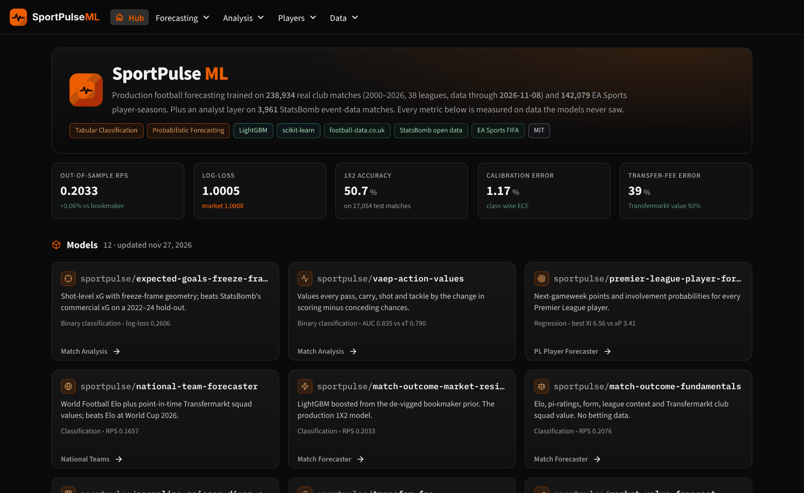
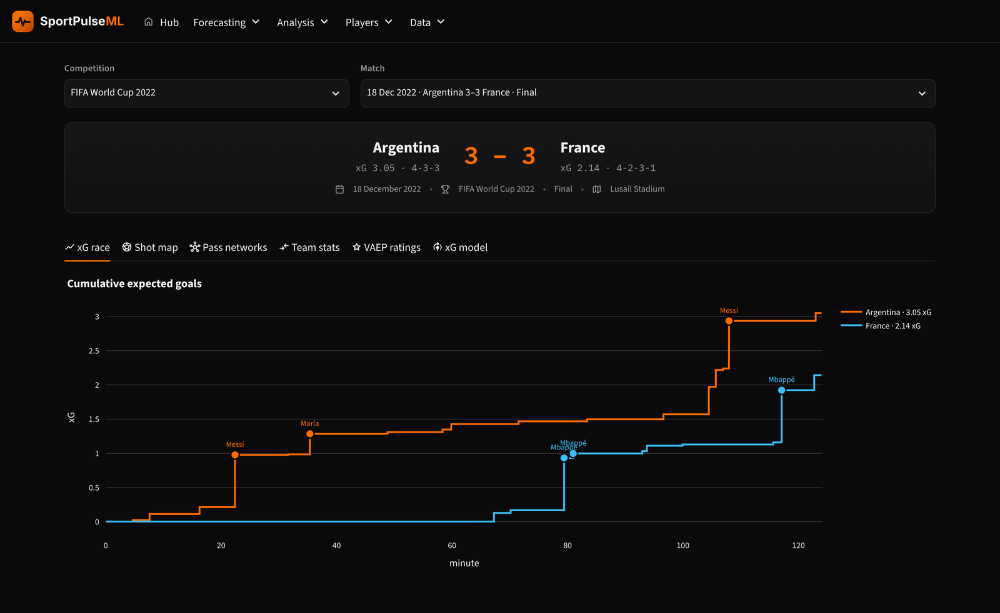
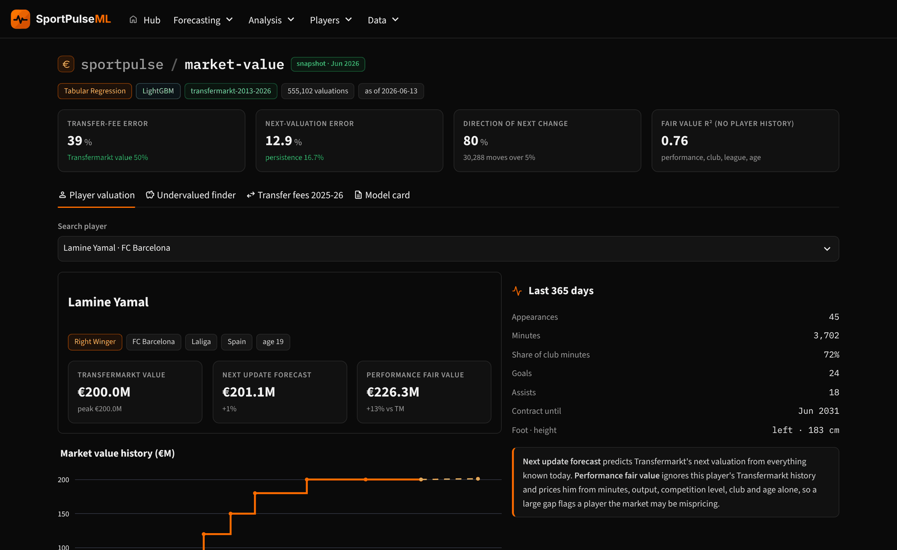

<p align="center">
  
</p>

<h1 align="center">SportPulse ML</h1>

<p align="center">
  <em>Football forecasting and analysis on real data: every model is scored on matches it never saw, against a named reference.</em>
</p>

<p align="center">
  <a href="https://github.com/BSujanK/SportPulse-ML/actions/workflows/ci.yml"></a>
  <a href="https://bsujank-sportpulse-ml-app-claudetender-hypatia-qfphwp-4amba4.streamlit.app"></a>
  <a href="LICENSE"></a>
  
</p>

<p align="center">
  <a href="https://bsujank-sportpulse-ml-app-claudetender-hypatia-qfphwp-4amba4.streamlit.app">Live app</a> ·
  <a href="docs/results.md">Results</a> ·
  <a href="docs/architecture.md">Architecture</a> ·
  <a href="docs/experiments.md">Experiment log</a> ·
  <a href="docs/data.md">Data</a>
</p>

---

SportPulse ML forecasts club and international football, values players, and analyses matches event by event.
It is built for analysts and builders who want models they can check: the data is public, the splits are
chronological, and every claim below links to the file it comes from.

- **Club results in 38 leagues.** A LightGBM model boosted from the bookmaker's de-vigged prices matches the
  market on 17,054 unseen matches; without odds it beats Elo and the classic Dixon-Coles model.
- **National teams.** World Football Elo plus point-in-time Transfermarkt squad values, ahead of standard Elo,
  including at the 2026 World Cup.
- **Event data.** An expected-goals model that beats StatsBomb's commercial xG on a 2022–24 hold-out, and VAEP
  values for every pass, carry, shot and tackle.
- **Players.** Transfer fees predicted better than Transfermarkt's own value, a valuation estimate, a
  performance-based fair value, and next-gameweek Fantasy Premier League points.
- **An app.** Twelve pages in a Hugging Face–style interface: forecasts, scouting reports, match reports,
  valuations and the full evaluation.

## Results

Scored on data held out from training. Lower is better except AUC. Full tables, test windows and baselines are in
[docs/results.md](docs/results.md); comparisons with published models are in [docs/comparison.md](docs/comparison.md).

<!-- RESULTS:START -->
| Task | Metric | SportPulse | Reference | Reference score |
|---|---|---|---|---|
| Club results, with odds | RPS ↓ | **0.2033** | Bookmaker (Shin) | 0.2035 |
| Club results, no odds | RPS ↓ | **0.2076** | Elo | 0.2103 |
| National teams | RPS ↓ | **0.1657** | World Football Elo | 0.1695 |
| National teams, World Cup 2026 | RPS ↓ | **0.1548** | World Football Elo | 0.1598 |
| Expected goals (2022–24 hold-out) | log-loss ↓ | **0.2525** | StatsBomb xG | 0.2563 |
| Action values (VAEP) | AUC ↑ | **0.835** | Expected threat (xT) | 0.790 |
| Transfer fees | median error ↓ | **41%** | Transfermarkt value | 50% |
| Next Transfermarkt valuation | median error ↓ | **12.9%** | Last value carried forward | 16.7% |
| Fantasy Premier League points | MAE ↓ | **0.874** | FPL's own xP | 1.092 |
<!-- RESULTS:END -->

## Quick start

The repository ships with trained models, so the app runs straight after install (Python 3.11):

```bash
git clone https://github.com/BSujanK/SportPulse-ML.git
cd SportPulse-ML
pip install -r requirements.txt
streamlit run app.py
```

Streamlit prints a local URL (`http://localhost:8501`); open it to reach the hub.
To check the models against their stored results:

```bash
pip install -r requirements-dev.txt
pytest -q
```

## What you can do

<p align="center">
  
</p>

| Page | What it answers |
|---|---|
| **Match Forecaster** | Win / draw / loss, expected goals, over/under 2.5, both teams to score and a scoreline grid for any two teams in a league. Add odds to switch to the market-informed model. |
| **National Teams** | World Elo ranking and a fixture predictor for any two nations, home or neutral. |
| **Leaderboard** | How each model compares with the bookmaker, Dixon-Coles and Elo, by league and by month, plus a betting backtest. |
| **Opponent Report** | A scouting report for a team in the StatsBomb competitions: style profile, cues, shot and pressing maps, key players. |
| **Match Analysis** | xG race, shot map, pass networks, team stats and VAEP player ratings for 3,961 matches. |
| **PL Player Forecaster** | Next-gameweek points and involvement probabilities for every Premier League player, and a budget best XI. |
| **Market Value** | Transfermarkt value history, the model's valuation estimate, a performance-based fair value, an undervalued finder and the 2025-26 fee test. |
| **Leagues** · **EA FIFA Scout** · **Archetypes** · **Datasets** | Standings and power ratings; EA FIFA rating forecasts; playing-style roles; a dataset viewer. |

<p align="center">
  
  
</p>

## How it works

- **One chronological pass.** A feature engine walks every match in date order and records each team's state
  *before* kick-off: margin-aware Elo, pi-ratings, weighted form, league context and de-vigged market prices. The
  same function builds live rows, and a test checks the two match exactly.
- **Market-residual boosting.** The production club model starts from the bookmaker's probabilities
  (`init_score = log p_market`) and learns only the corrections. A separate model without odds serves forecasts
  when no prices are entered.
- **Point-in-time Transfermarkt features.** Club and national squad values, and every player feature, use only
  rows dated before the prediction and only clubs the data covered that season, so later careers cannot leak in.
- **Event models.** xG uses shot geometry and StatsBomb freeze-frames (visible goal mouth, blockers, keeper
  position) under monotone constraints. VAEP scores each action by its change in scoring and conceding chances.
- **Strict evaluation.** Train, validate and test windows are chronological. A change is kept only when it helps
  on both the validation and the test window; every attempt is in the [experiment log](docs/experiments.md).

Details for each model: [docs/architecture.md](docs/architecture.md).

## Train from scratch

Downloads about 300 MB of public data and retrains every model (about an hour on 4 CPU cores):

```bash
pip install -r requirements-dev.txt
python -m sportpulse.train all
python scripts/render_results.py      # regenerate docs/results.md and the table above
```

Each part can also run on its own: `matches`, `international`, `fpl`, `analyst`, `vaep`, `value` and `players`
(for example `python -m sportpulse.train fpl --refresh` pulls the newest gameweek). The Transfermarkt download
needs network access to the dataset's host; without it, the committed snapshots are used.

## Limitations

- **Odds.** With odds, the club model matches the market (paired test z = −1.3), a consistent but not
  statistically significant edge. Beating a liquid market significantly with public data alone would be unusual.
- **Test windows were also used to accept changes,** alongside validation, so headline numbers are slightly
  optimistic. The [experiment log](docs/experiments.md) shows every decision.
- **Frozen sources.** The Transfermarkt snapshot stops in July 2026 and the EA FIFA data at FIFA 22, so squad
  values and player ratings do not reflect later moves.
- **Live inputs.** Entering odds in the app fills only the 1X2 prices; over/under and Asian-handicap inputs stay
  empty, as the model handles for missing data. StatsBomb own goals are not yet ingested.
- **Licences.** StatsBomb open data is CC BY-NC-SA 4.0 (non-commercial). A commercial deployment would need a
  licensed event feed. See [docs/data.md](docs/data.md) for every source.

## Contributing

Issues and pull requests are welcome. Run `pytest -q` before opening a PR; CI runs the same tests with `ruff`.
New model changes should report their validation and test effect in [docs/experiments.md](docs/experiments.md).

## Citation

```bibtex
@software{sportpulse_ml,
  author = {Kumar, B Sujan},
  title  = {SportPulse ML: football forecasting and analysis on real data},
  url    = {https://github.com/BSujanK/SportPulse-ML},
  year   = {2026}
}
```

## Licence

Code: [MIT](LICENSE). Data keeps its own licence: StatsBomb open data CC BY-NC-SA 4.0 (*data provided by
StatsBomb*); other sources are listed in [docs/data.md](docs/data.md).
